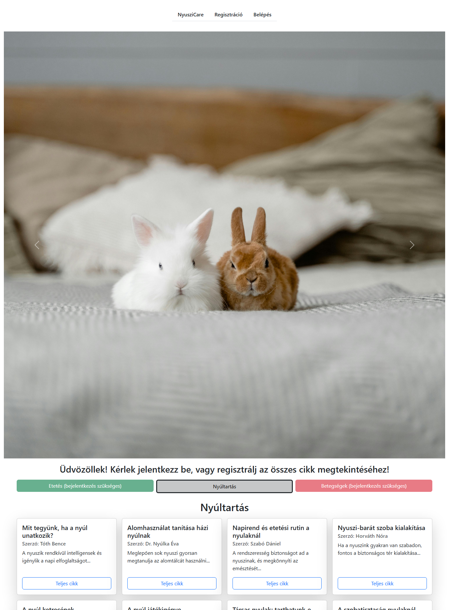
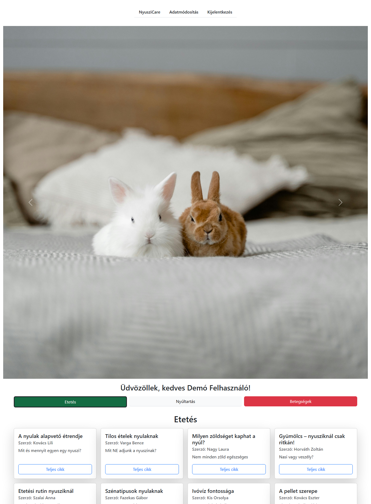
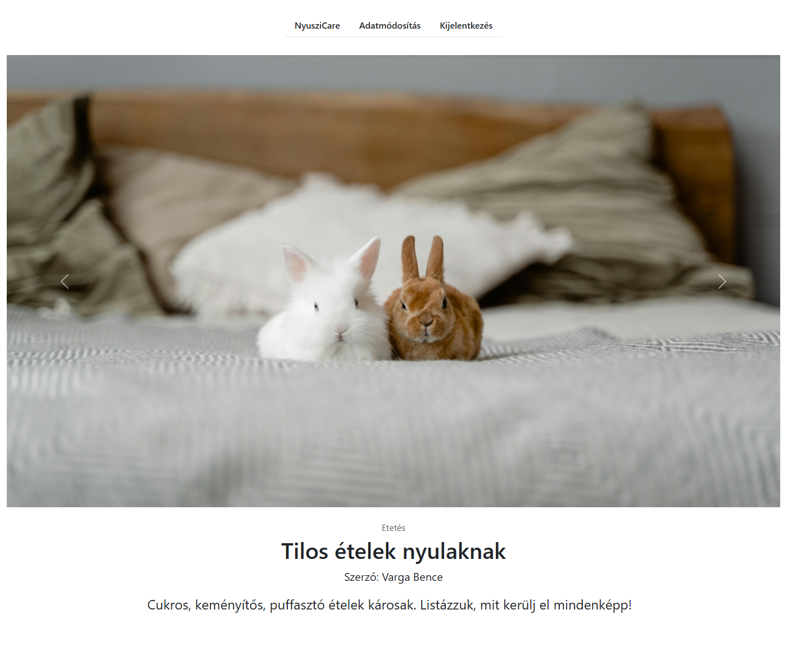
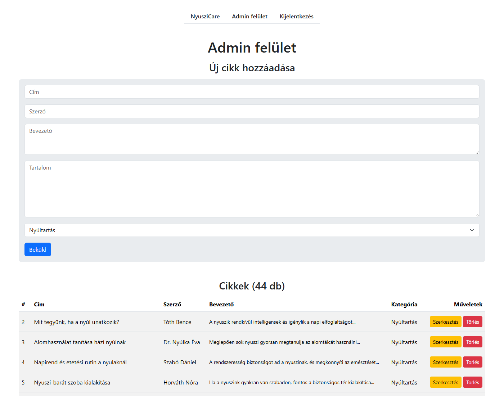
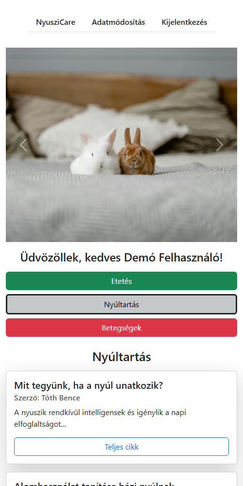

# 🐰 NyusziCare – Cikkgyűjtemény nyúltartóknak


A **NyusziCare** egy PHP-ban, keretrendszer nélkül írt webalkalmazás, ahol nyúltartással, etetéssel és a nyulak betegségeivel kapcsolatos cikkek olvashatók. A látogatók a nyúltartási cikkeket szabadon böngészhetik, a többi kategóriához regisztráció szükséges. Az adminisztrátor egy külön felületen kezeli a cikkeket.



## Funkciók

**Látogatóknak és felhasználóknak**
- Cikkek kategóriák szerint (Nyúltartás, Etetés, Betegségek), kártyás elrendezésben, lapozással
- Regisztráció hírlevél-feliratkozással, belépés, kijelentkezés
- Profil adatainak (név, email, jelszó) módosítása a jelenlegi jelszó megadásával
- A zárt kategóriák cikkei csak bejelentkezve olvashatók, közvetlen URL-ről sem érhetők el
- Reszponzív megjelenés, mobilon is használható

**Adminisztrátornak**
- Új cikk felvétele, meglévő cikkek szerkesztése és törlése
- Szerveroldali validáció, hibás beküldésnél a beírt adatok megmaradnak
- Demó mód: a nyilvános bemutatón az admin felület csak olvasható

## Biztonság

- **SQL injection ellen:** minden lekérdezés prepared statementtel fut (`mysqli_prepare`)
- **XSS ellen:** minden kiírt adat `htmlspecialchars`-on megy át
- **CSRF védelem:** minden űrlap (a kijelentkezés is) egyedi tokennel védett
- **Jelszavak:** `password_hash` / `password_verify` (bcrypt), a hash nem kerül a sessionbe
- **Session:** `HttpOnly` és `SameSite` süti, új session azonosító belépéskor
- **Jogosultság:** szerveroldali ellenőrzés minden oldalon és műveletnél
- Belépéskor egységes hibaüzenet, így nem deríthető ki, mely email címek vannak regisztrálva
- A konfigurációs és SQL fájlok böngészőből nem érhetők el, a jelszavak nincsenek a repóban

## Technológiák

| Terület | Eszköz |
|---|---|
| Backend | PHP 8 (procedurális, keretrendszer nélkül), mysqli |
| Adatbázis | MySQL / MariaDB |
| Frontend | HTML5, Bootstrap 5.3, saját CSS |
| Fejlesztői környezet | XAMPP, Docker Compose |
| CI | GitHub Actions (PHP szintaxis ellenőrzés) |

## Képernyőképek

| Kategória nézet (bejelentkezve) | Cikk |
|---|---|
|  |  |

| Admin felület | Mobil nézet |
|---|---|
|  |  |

## Futtatás helyben

### 1. lehetőség: XAMPP

1. Másold a projekt mappáját a `htdocs` mappába (pl. `C:\xampp\htdocs\nyuszicare`).
2. Indítsd el az Apache-ot és a MySQL-t a XAMPP vezérlőpultból.
3. A phpMyAdminban hozz létre egy `nyuszicare` nevű adatbázist (`utf8mb4_unicode_ci`), majd importáld a [`database/nyuszicare.sql`](database/nyuszicare.sql) fájlt.
4. Nyisd meg: <http://localhost/nyuszicare/>

Az alapbeállítás a XAMPP alapértékeit használja (`root` felhasználó, jelszó nélkül). Ha ettől eltérő adatbázist használsz, másold le az `includes/db_config.local.example.php` fájlt `db_config.local.php` néven, és írd át benne az adatokat.

### 2. lehetőség: Docker

```bash
docker compose up
```

Ezután az oldal elérhető itt: <http://localhost:8080>. Az adatbázis és a mintaadatok első indításkor automatikusan betöltődnek.

## Demó fiókok

| Szerep | Email | Jelszó |
|---|---|---|
| Felhasználó | `demo@nyuszicare.hu` | `Demo1234` |
| Admin | `admin@nyuszicare.hu` | `Admin1234` |

Az admin ugyanazon a belépési oldalon jelentkezik be, és utána az admin felületre kerül.

## Projekt felépítése

```
├── index.php                 Főoldal: kategóriák, cikk kártyák, lapozás
├── cikk.php                  Egy cikk teljes szövege
├── logout.php                Kijelentkezés
├── login/                    Belépés űrlap és feldolgozás
├── registration/             Regisztráció űrlap és feldolgozás
├── profile/                  Adatmódosítás űrlap és feldolgozás
├── admin/                    Admin felület és cikkkezelés
├── includes/
│   ├── init.php              Session, beállítások, adatbázis-kapcsolat
│   ├── functions.php         Segédfüggvények (escape, CSRF, jogosultság, lekérdezések)
│   ├── db_config.php         Beállítások (környezeti változókból vagy helyi fájlból)
│   └── header.php, footer.php, navbar.php, carousel.php
├── assets/                   CSS és képek
├── database/nyuszicare.sql   Táblák és mintaadatok
└── docker-compose.yml        Helyi futtatás Dockerrel
```

## Adatbázis

| Tábla | Tartalom |
|---|---|
| `users` | Regisztrált felhasználók (név, egyedi email, jelszó hash, hírlevél, regisztráció ideje) |
| `adminok` | Adminisztrátorok |
| `cikkek` | Cikkek: cím, szerző, bevezető, tartalom, kategória (`ENUM`, indexelve) |

---

Készítette: **Polák András**
